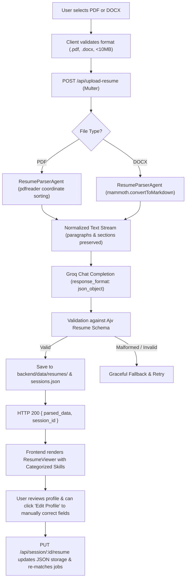
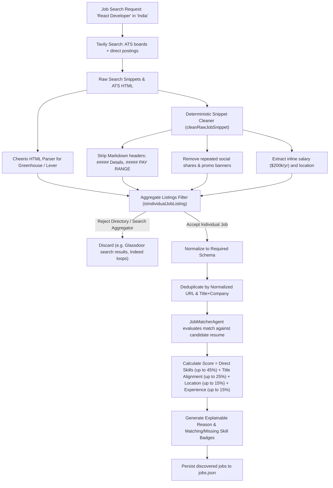
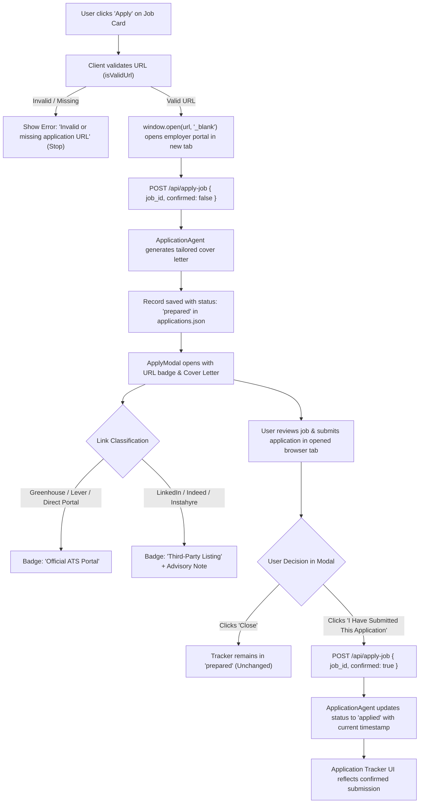

# Complete Application Flow: AI Job Assistant

This document walks through every phase of the **AI Job Assistant** user lifecycle, tracing data from user interaction to backend processing, external API calls, and persistent storage.

---

## Flow A: Resume Upload & Structured Profile Extraction



### Step-by-Step Breakdown:
1. **User Action:** Candidate uploads a resume via drag-and-drop or file picker in `ResumeUploader.tsx`.
2. **Client Validation:** Frontend checks that the file extension is `.pdf` or `.docx` and size is $\le 10\text{MB}$.
3. **Multipart Ingestion:** `multer` receives the stream on `POST /api/upload-resume`, generating a unique disk filename in `backend/data/uploads/` while preserving the original filename in metadata.
4. **Coordinate-Aware Extraction:**
   - For PDFs, `pdfreader` tracks every character token's `(x, y)` coordinates. Items with $|y_1 - y_2| \le 0.25$ are grouped into the same visual line; vertical gaps $> 1.2$ trigger paragraph breaks. This prevents multi-column layouts from merging unrelated columns into run-on text.
   - For DOCX, `mammoth.convertToMarkdown()` converts XML formatting into clean markdown bullet points and headings.
5. **AI Structured Parsing:**
   - Raw text is passed to Groq (`openai/gpt-oss-20b`) with a system prompt enforcing strict anti-hallucination rules (never invent dates or companies, separate personal projects from corporate employment, return `null` for missing scalar fields).
   - Configured with `response_format: { type: "json_object" }`.
6. **Schema Validation:**
   - Validated against an Ajv JSON schema in `backend/utils/validation.js` requiring: `name`, `email`, `phone`, `skills`, `skillsByCategory`, `experience`, `education`, `projects`, and `certifications`.
7. **Session Storage:**
   - The structured profile is stored in `backend/data/resumes/${sessionId}.json` and updated in `sessions.json` via atomic file write.
8. **UI Presentation & Review Mode:**
   - Extracted information is rendered in `ResumeViewer.tsx` in clearly separated sections: Contact Header, Categorized Skills (Languages, Frameworks, Developer Tools, Databases), Professional Experience, Projects, and Education (with CGPA badge).
   - If any field was extracted imperfectly, the user clicks **"Edit Profile"**, adjusts the text or adds/removes items, and clicks **"Save & Re-match Jobs"**, which calls `PUT /api/session/:sessionId/resume` to update the persistent profile and recalculate match scores.

---

## Flow B: AI Chat & Tool Calling Loop

```mermaid
flowchart TD
    A["User sends message: 'Find Node.js jobs in India'"] --> B["POST /api/chat { message, session_id }"]
    B --> C["OrchestratorAgent loads session & appends user message"]
    C --> D["Context Injection (candidate skills, title, location in system prompt)"]
    D --> E["Groq Chat Completion with 4 Tool Definitions"]
    E --> F{"Does LLM invoke a tool?"}
    F -->|Tool Call: searchJobs| G["JobSearchAgent.search(query, location)"]
    F -->|Tool Call: matchJobs| H["JobMatcherAgent.match(resume, jobs)"]
    F -->|Tool Call: prepareApplication| I["ApplicationAgent.prepareApplication(jobId)"]
    F -->|Tool Call: getApplicationHistory| J["ApplicationTrackerAgent.getUserApplications(sessionId)"]
    F -->|No Tool (Conversational)| K["Generate Direct Text Response"]
    G --> L["Append tool execution result to message history"]
    H --> L
    I --> L
    J --> L
    L --> M{"Tool Call Count < 5?"}
    M -->|Yes| E
    M -->|No (Loop Guard)| N["Force Final Summary Response"]
    K --> O["Persist conversation to sessions.json"]
    N --> O
    O --> P["HTTP 200 { response, recommended_jobs, applied_jobs }"]
    P --> Q["ChatWindow renders assistant markdown & interactive Job Cards"]
```

### Step-by-Step Breakdown:
1. **Message Submission:** Candidate types a natural language request in `ChatWindow.tsx`.
2. **Session Context Hydration:** `OrchestratorAgent` fetches the active session from memory/`sessions.json` and enriches the system prompt with the candidate's name, target role, and top skills.
3. **Tool Definition Binding:** Four tools are exposed to Groq:
   - `searchJobs({ query, location, remote })`
   - `matchJobs({ sessionId })`
   - `prepareApplication({ jobId, sessionId })`
   - `getApplicationHistory({ sessionId })`
4. **Tool Execution:** Groq inspects the user message and issues a structured tool call. The orchestrator executes the tool locally and returns the result as a `tool` role message.
5. **Infinite Loop Guard:** An iteration counter tracks tool executions. If the model attempts more than 5 consecutive tool calls, the loop halts, forcing a final conversational summary.
6. **Conversational Synthesis:** Groq receives the tool output and drafts a brief, helpful summary (1–2 sentences).
7. **Frontend Rendering:** `ChatWindow.tsx` displays the assistant's message formatted via `ReactMarkdown`, automatically rendering interactive, clickable `JobCard` components directly underneath.

---

## Flow C: Job Discovery, Cleaning & Matching



### Step-by-Step Breakdown:
1. **Targeted Discovery:** `JobSearchAgent` executes a two-pronged search:
   - Targeted ATS search: Queries Greenhouse and Lever public boards for verified listings.
   - Direct web search: Queries Tavily using exclusions (`-intitle:"jobs in" -intitle:"vacancies"`).
2. **Deterministic Data Cleaning (`cleanRawJobSnippet`):**
   - Strips noisy Markdown headers (`##### Details`, `##### PAY RANGE`, `##### LOCATION`).
   - Removes repeated share prompts (`Share #### Share`, `Share on LinkedIn`).
   - Removes marketing fluff (`APPLY NOW`, `Earn up to`, `Boost your creativity...`).
   - Extracts inline compensation (e.g. `$200,000 USD/year` or `₹25L - ₹35L`) and geographical location.
3. **Aggregator / Directory Rejection (`isIndividualJobListing`):**
   - Filters out directory landing pages matching patterns like `\b\d+[\d,]*\+?\s+jobs in\b` or URLs containing `/jobs?q=`, `/search?`, Glassdoor `-srch_`, Indeed `/q-`, Wellfound `/role/`, or Reddit discussion threads.
4. **Structured Schema Normalization:** Every accepted job adheres to:
   ```json
   {
     "id": "uuid",
     "title": "Cleaned Title",
     "company": "Cleaned Company",
     "location": "Location",
     "employmentType": "Full-time",
     "experienceLevel": "Senior | Mid-level | Entry-level",
     "salary": "$200,000 USD/year | null",
     "description": "Readable description without markdown artifacts",
     "responsibilities": ["..."],
     "requirements": ["..."],
     "skills": ["React", "Node.js", "TypeScript"],
     "applicationUrl": "https://...",
     "sourceUrl": "https://...",
     "source": "greenhouse | tavily",
     "publishedDate": "2026-11-03T..."
   }
   ```
5. **Multi-Factor Scoring (`jobMatcherAgent.js`):**
   - Compares candidate skills against job requirements.
   - Computes match percentage: Direct Skills (up to 70%) + Title Alignment (up to 20%) + Location Compatibility (up to 15%), capped at 100%.
   - Populates `matchingSkills` (e.g., `["React", "Node.js"]`) and `missingSkills` (e.g., `["Docker", "AWS"]`).

---

## Flow D: Tailored Cover Letter Generation

1. **Trigger:** User clicks **"Apply"** on a job card or asks the chat assistant to draft a cover letter.
2. **Context Assembly:** `ApplicationAgent` extracts:
   - Candidate's actual name, top 15 skills, professional experience achievements, and degrees.
   - Target job position, company name, location, and key requirements.
3. **Anti-Hallucination Prompting:** Groq is instructed to connect real candidate achievements to the employer's stated requirements in under 280 words, with strict instructions never to fabricate unlisted experience or metrics.
4. **Presentation:** Displayed inside `ApplyModal.tsx` in a monospace code container with a 1-click **"Copy Text"** button for pasting into the employer's portal.

---

## Flow E: Safe Manual Apply Workflow



### Why Automated Submission is Disabled:
- Automatic form submission via headless browsers often violates website Terms of Service, triggers CAPTCHAs, fails on custom multi-step questionnaires, and risks submitting inaccurate candidate data.
- The safe manual workflow preserves candidate control while eliminating the friction of finding the official application portal and drafting tailored cover letters.

---

## Flow F: File-Based JSON Persistence

```
Client Request
      │
      ▼
Server Route Handler
      │
      ▼
fileStore.upsert('sessions', sessionData)
      │
      ├─► 1. Serialize to JSON: JSON.stringify(data, null, 2)
      ├─► 2. Write to hidden temp file: .sessions.json.tmp.<pid>
      ├─► 3. Atomic rename: fs.renameSync(tempFile, targetFile)
      └─► 4. If read error: copy to sessions.json.bak.<timestamp> and recover
```

- **Surviving Restarts:** On server startup, `orchestratorAgent._loadPersistedSessions()` reads `backend/data/sessions.json` and populates the in-memory map.
- **Render Production Mounting:** In production, Render's persistent disk is mounted at `/data`. Setting `STORAGE_DIR=/data` ensures all application records, sessions, and uploaded resumes persist across redeployments.
