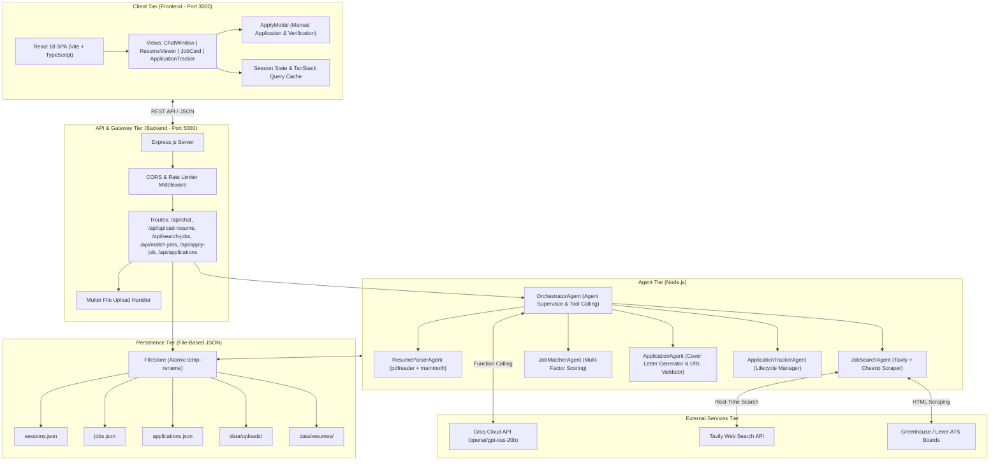
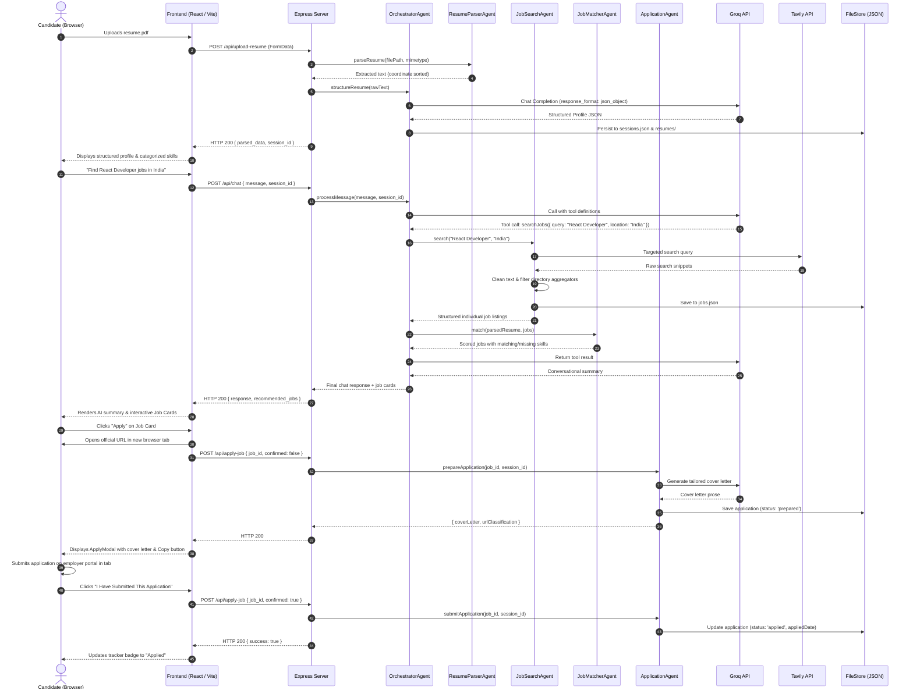

# System Architecture: AI Job Assistant

This document provides a comprehensive technical breakdown of the system architecture, component responsibilities, data models, communication flows, and algorithms powering the **AI Job Assistant**.

---

## 1. Architectural Overview & Mermaid Diagram

The system employs a **Decoupled Client-Server Multi-Agent Architecture**:
- **Client Tier:** Single Page Application (SPA) built with React 18, TypeScript, and Vite.
- **Server Tier:** Express.js REST API with modular agent controllers.
- **Agentic Tier:** Coordinated by `OrchestratorAgent` using Groq tool calling for dynamic intent resolution.
- **Persistence Tier:** Atomic JSON document store with configurable directory routing for local development and production cloud disks (Render `/data`).



---

## 2. Frontend Architecture (`frontend-new`)

### 2.1 Component Hierarchy & Responsibilities

```
App.tsx (Root Layout & Global Session Controller)
 ├── Sidebar.tsx (Navigation & Active Counters)
 ├── Main Content View Container
 │    ├── ChatWindow.tsx (Interactive Conversational Agent View)
 │    │    └── ReactMarkdown + Inline Action Recommendations
 │    ├── ResumeUploader.tsx (Drag & Drop File Upload with Client Validation)
 │    ├── ResumeViewer.tsx (Profile Display + Review & Manual Edit Form)
 │    ├── JobCard.tsx (Job Listing, Badges, Expandable Details, Apply Triggers)
 │    └── ApplicationHistory.tsx (Kanban/Table Tracker for Application Statuses)
 └── ApplyModal.tsx (Verified URL Linker, Cover Letter Viewer, Manual Confirmation)
```

### 2.2 Client-Side State & Session Management
- **`useSession.ts` Hook:** Manages persistent session IDs stored in browser `localStorage` (`ai_job_assistant_session_id`). Survives browser tab closing and hard refreshes.
- **Hydration Lifecycle:** On mount, `App.tsx` invokes `GET /api/session/:sessionId`. The server hydrates `parsedResume`, `resumeFilename`, `jobs`, `matched`, and `conversationHistory`.
- **TanStack React Query:** Handles server-state caching, automatic cache invalidation (`applications`, `jobs`), and background refetching.

### 2.3 URL Classification Helper (`frontend-new/src/lib/urlUtils.ts`)
Inspects application URLs before opening to classify destinations:
- **Official ATS / Direct Portals:** Greenhouse, Lever, Ashby, Workday, SmartRecruiters, or direct company domains (`isDirectPortal = true`).
- **Third-Party / Aggregator Listings:** LinkedIn, Indeed, Glassdoor, Naukri, Instahyre (`isDirectPortal = false`, displays advisory notice).
- **Invalid / Missing URLs:** Non-HTTP, empty, fragment `#`, or malformed URLs (disables apply action and shows error).

---

## 3. Backend Architecture (`backend`)

### 3.1 Server Layer (`backend/server.js`)
- **Express.js Framework:** Lightweight, asynchronous REST API.
- **Security Middleware:**
  - `cors`: Validates incoming `Origin` against configured `FRONTEND_URL` and local development origins, normalizing trailing slashes.
  - `express-rate-limit`: Protects endpoints against denial-of-service (120 requests per minute).
  - `multer`: Restricts file uploads to `.pdf` and `.docx` with a 10MB file-size limit.
- **Error Handling:** Centralized Express error-handling middleware returning standardized JSON: `{ error: string }`.

### 3.2 Agent Tier

#### 1. `OrchestratorAgent.js` (The Supervisor)
- **Role:** Central multi-agent coordinator and session state manager.
- **Groq Tool Calling:** Binds tools (`searchJobs`, `matchJobs`, `prepareApplication`, `getApplicationHistory`) to Groq completions.
- **Conversation Context:** Injects candidate summary (name, role, skills) into the LLM system prompt so the assistant maintains conversational memory.
- **Anti-Loop Mechanism:** Enforces a maximum iteration limit (5 tool calls) and maintains call history to prevent infinite LLM loops.

#### 2. `ResumeParserAgent.js` (Document Extraction)
- **PDF Extraction:** Uses `pdfreader` with coordinate sorting:
  - Groups glyphs into visual lines based on vertical closeness: $|y_1 - y_2| \le 0.25$.
  - Detects paragraph breaks when vertical separation $\Delta y > 1.2$.
  - Preserves multi-column layout order without horizontal text collisions.
  - Fallback to `pdf-parse` if coordinate extraction encounters corrupted font tables.
- **DOCX Extraction:** Uses `mammoth.convertToMarkdown()` to convert `.docx` documents into structured Markdown, preserving headings and bullet lists.

#### 3. `JobSearchAgent.js` (Live Discovery & Cleaning)
- **Targeted ATS Search:** Uses Tavily with search modifiers:
  `'("Full Stack Developer") (site:boards.greenhouse.io OR site:jobs.lever.co)'`
- **ATS Board Scraping:** For discovered Greenhouse/Lever boards, uses Cheerio to parse semantic HTML (`<p>`, `<li>`, job metadata) directly from the public board API/HTML.
- **Deterministic Cleaning (`cleanRawJobSnippet`):**
  - Removes Markdown headers (`##### Details`, `##### PAY RANGE`).
  - Strips repetitive social sharing strings (`Share #### Share`).
  - Removes promotional fluff (`APPLY NOW`, `Earn up to`, `Boost your creativity...`).
  - Extracts inline salary (e.g. `$200,000 USD/year`) and location.
- **Aggregator / Directory Rejection (`isIndividualJobListing`):**
  - Rejects aggregator titles matching patterns like `\b\d+[\d,]*\+?\s+jobs in\b`, search query URLs (`/jobs?q=`, `/search?`, Glassdoor `-srch_`, Indeed `/q-`, Wellfound `/role/`, Naukri directories, Reddit/Quora threads).

#### 4. `JobMatcherAgent.js` (Deterministic Match Engine)
- **Role:** Compares candidate skills against job requirements using a weighted scoring formula.
- **Scoring Formula:**
  $$\text{Score} = \min(100, \max(10, \text{Round}(S_{\text{skill}} + S_{\text{title}} + S_{\text{location}} + S_{\text{experience}})))$$
  Where:
  - **Direct Skill Overlap ($S_{\text{skill}}$ - 0 to 45 pts):** Match ratio against job skills: $\min(45, \text{Round}(\frac{N_{\text{matched}}}{N_{\text{required}}} \times 45))$. If job requirements lack explicit skill tags, awards 9 points per matched skill up to 45.
  - **Title & Role Alignment ($S_{\text{title}}$ - 0 to 25 pts):** Token overlap between candidate designation and job title: $\text{Round}(\frac{T_{\text{matched}}}{T_{\text{total}}} \times 25)$ (defaults to neutral 12 points if no title specified).
  - **Location Compatibility ($S_{\text{location}}$ - 0 to 15 pts):** 15 points if job is Remote or candidate city matches job location; 5 points otherwise.
  - **Experience & Requirements ($S_{\text{experience}}$ - 0 to 15 pts):** 10 points for documented experience; 15 points if past work descriptions mention technologies required in the posting.
- **Classification Thresholds:**
  - $\ge 70$: "High Match – Strongly recommended to apply"
  - $45 - 69$: "Good Match – Meets core profile skills"
  - $< 45$: "Potential Match – Review missing requirements"
- **Explainability:** Returns `{ score, reason, matchingSkills, missingSkills, recommendation }`.

#### 5. `ApplicationAgent.js` (Cover Letter & Apply Safety)
- **Tailored Cover Letter Generation:** Prompts Groq to connect candidate resume achievements directly to the target job description under 280 words with zero hallucination.
- **Application Validation:** Validates application URL with `urlHelper.js`.
- **Safe Manual Submission:** Updates application status to `'applied'` **only** when user explicitly confirms manual submission on the employer portal.

#### 6. `ApplicationTrackerAgent.js` (Lifecycle State Manager)
- **Role:** Queries and updates application statuses in `applications.json`.
- **Supported Statuses:** `saved`, `interested`, `prepared`, `applied`, `interview`, `offer`, `rejected`.

---

## 4. Persistence Architecture (`backend/utils/fileStore.js`)

Instead of an external database service, the system uses an atomic JSON file storage engine:

### 4.1 Storage Layout
```
backend/data/ (or STORAGE_DIR=/data in Render production)
 ├── sessions.json          (Session state, parsed resumes, job cache)
 ├── jobs.json              (Latest discovered job listings)
 ├── applications.json      (Application tracker records)
 ├── resumes/               (Per-session parsed resume JSON files)
 └── uploads/               (Original uploaded PDF and DOCX files)
```

### 4.2 Atomic Write Algorithm
To eliminate race conditions, corrupted files, and incomplete writes on system crash:
1. Data is serialized to formatted JSON.
2. Written to a hidden temporary file: `.${filename}.tmp.${pid}`.
3. Synchronously renamed to the target filename via `fs.renameSync()`.
4. Because POSIX and Windows rename operations are atomic at the filesystem level, readers never see partial writes.
5. If corrupted JSON is detected on read, `fileStore` automatically creates a timestamped backup (`.bak.${timestamp}`) and recovers gracefully without crashing.

---

## 5. Sequence Diagram: Complete End-to-End User Flow


