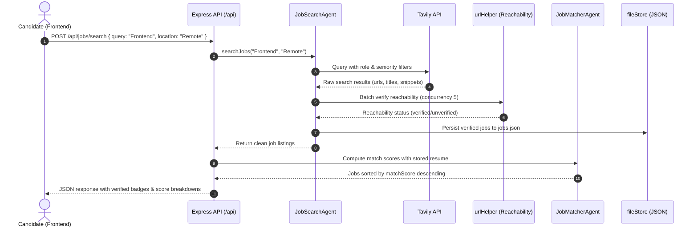

# Codebase Deep Dive: File-by-File Architecture & Implementation

This document provides a line-level, file-by-file engineering deep dive into the **AI Job Assistant** codebase. It covers the frontend and backend architectures, exact component contracts, data pipelines, state management, and edge-case error handling—tailored for SDE interview preparation.

---

## 1. Directory & File Organization Overview

```
jobSearch-asistent/
├── frontend-new/                    # React 18 + Vite + TypeScript + Tailwind CSS Frontend
│   ├── src/
│   │   ├── components/
│   │   │   ├── JobCard.tsx          # Card displaying job details, badges, ATS verification, score breakdown
│   │   │   ├── ApplicationHistory.tsx # Tracker table with interactive status pipeline dropdown
│   │   │   ├── ChatWindow.tsx       # AI Agent Copilot chat interface (Groq orchestrator)
│   │   │   ├── ResumeViewer.tsx     # Parsed resume JSON visualization (skills, experience, contact)
│   │   │   ├── ResumeUploader.tsx   # Drag-and-drop PDF/DOCX file uploader
│   │   │   ├── ApplyModal.tsx       # Safe application launcher with official URL check
│   │   │   ├── ui/                  # Reusable shadcn/ui components (button, badge, toast, etc.)
│   │   │   └── Layout.tsx           # Main application shell with collapsible sidebar & navigation
│   │   ├── lib/
│   │   │   ├── api.ts               # Centralized Axios API client with error handling
│   │   │   └── urlUtils.ts          # URL classification (ATS vs Third-Party) & safe opener
│   │   ├── App.tsx                  # Root application component with tabs, global state & TanStack Query
│   │   └── main.tsx                 # React entry point with QueryClientProvider & Toaster
│   ├── package.json
│   ├── tsconfig.json
│   ├── vite.config.ts
│   └── vercel.json                  # SPA routing configuration for Vercel deployment
│
├── backend/                         # Node.js + Express REST API Backend
│   ├── agents/                      # Specialized Agentic Architecture
│   │   ├── orchestratorAgent.js     # ReAct Agent loop with Groq LLM tool calling
│   │   ├── jobSearchAgent.js        # Seniority-aware Tavily query generator & job scraper
│   │   ├── jobMatcherAgent.js       # Mathematical 4-factor scoring algorithm (0-100)
│   │   ├── resumeAgent.js           # Multi-format parser (pdf-parse / mammoth) + LLM extractor
│   │   ├── applicationAgent.js      # Personalized cover letter & resume tailoring generator
│   │   └── applicationTrackerAgent.js # Application pipeline lifecycle manager
│   ├── utils/
│   │   ├── fileStore.js             # Atomic, thread-safe JSON persistence with disk fallback
│   │   ├── urlHelper.js             # URL classification, cleaning & parallel reachability checks
│   │   └── rateLimiter.js           # Express in-memory IP rate limiter
│   ├── server.js                    # Express HTTP server, routes, CORS & error middleware
│   ├── data/                        # Local persistent JSON files (applications.json, jobs.json, etc.)
│   └── package.json
│
└── docs/                            # Documentation & Technical Interview Guides
    └── interview-preparation/
```

---

## 2. Frontend Architecture & Component Deep Dive

### 2.1 `frontend-new/src/lib/api.ts` (API Client & Types)
* **Purpose:** Single source of truth for all network communication with the backend. Exposes strongly typed async functions and TypeScript interfaces.
* **Base URL Resolution:**
  ```typescript
  const API_BASE_URL = import.meta.env.VITE_API_URL || 'http://localhost:5000';
  ```
  Uses Vite's environment variable `VITE_API_URL` when deployed on Vercel, defaulting gracefully to `http://localhost:5000` in local development.
* **Core Interfaces:**
  - `Job`: Includes `id`, `title`, `company`, `location`, `salary`, `description`, `requirements`, `matchScore`, `matchBreakdown`, `url`, `applyUrl`, `source`, `verificationStatus` (`'verified' | 'unverified' | 'expired' | 'invalid'`), and `lastVerifiedAt`.
  - `Application`: Tracks `id`, `jobId`, `jobTitle`, `company`, `status`, `coverLetter`, `tailoredResume`, `appliedAt`, `notes`.
  - `ParsedResume`: Strongly typed extraction with `name`, `email`, `skills`, `experienceYears`, `education`.
* **Key Functions:**
  - `searchJobs(query, options)`: Calls `POST /api/jobs/search`.
  - `getMatchedJobs()`: Calls `GET /api/jobs/matched`.
  - `uploadResume(file)`: Sends `multipart/form-data` to `POST /api/resume/upload`.
  - `updateApplicationStatus(id, status)`: Calls `PATCH /api/applications/:id`.
  - `sendChatMessage(message, history)`: Calls `POST /api/chat`.
* **Interview Talking Points:**
  - Standardized error handling: all API calls wrap errors and throw clean `new Error(err.response?.data?.message || err.message)`.
  - Type-safe contract alignment between frontend TypeScript types and backend Express payloads prevents silent runtime UI bugs.

---

### 2.2 `frontend-new/src/lib/urlUtils.ts` (URL Safety & Classification)
* **Purpose:** Ensures the application never exposes users to unsafe URLs or misleads them about application destinations.
* **Link Classification:**
  ```typescript
  export function classifyUrl(url: string): { isDirectAts: boolean; label: string; badgeVariant: string }
  ```
  - Categorizes URLs into **Official ATS** (`greenhouse.io`, `lever.co`, `workday.com`, `ashbyhq.com`, `smartrecruiters.com`, etc.) vs **Third-Party Listing** (`indeed.com`, `linkedin.com`, `glassdoor.com`, `unstop.com`, etc.).
  - Shows clear badges: `"Official ATS / Direct"` vs `"Third-Party Job Listing"`.
* **Safe External Opener:**
  ```typescript
  export function openExternalUrl(url: string): boolean {
    const parsed = new URL(url);
    if (!['http:', 'https:'].includes(parsed.protocol)) return false;
    window.open(url, '_blank', 'noopener,noreferrer');
    return true;
  }
  ```
  - Protects against `javascript:` or `data:` XSS vectors.
  - Adds `rel="noopener noreferrer"` to prevent the opened window from accessing `window.opener`.

---

### 2.3 `frontend-new/src/components/JobCard.tsx` (Job Presentation & Actions)
* **Purpose:** Rich SaaS-styled component rendering a job listing, match score pills, verified badge, skills gap analysis, and interactive application drawer.
* **Key Visual & UX Elements:**
  - **Verification Badge:** Green checkmark badge (`"Verified Active"` or `"Live Listing"`) if `verificationStatus === 'verified'`.
  - **ATS Source Badge:** Distinct pill denoting whether the link is an ATS or aggregator.
  - **Match Score Progress:** Color-coded (Green $\ge 80\%$, Amber $\ge 60\%$, Gray $< 60\%$) with tooltip breaking down Skill, Title, Location, and Experience scores.
  - **Skills Comparison:** Green badges for candidate's matching skills; subtle dotted badges for missing skills.
  - **Expandable Accordion:** Displays detailed job description and key requirements without cluttering the initial viewport.
* **Action Handlers:**
  - `handleQuickApply()`: Opens `ApplyModal` containing the direct official application URL.
  - `handleSaveJob()`: Saves the job directly to the user's tracker via `POST /api/applications`.

---

### 2.4 `frontend-new/src/components/ApplicationHistory.tsx` (Application Tracker)
* **Purpose:** Kanban/table pipeline management for all jobs the user has saved, applied to, or interviewed for.
* **Interactive Status Dropdown:**
  - Dropdown allows immediate transition between statuses: `saved` $\rightarrow$ `interested` $\rightarrow$ `prepared` $\rightarrow$ `applied` $\rightarrow$ `interview` $\rightarrow$ `offer` $\rightarrow$ `rejected`.
  - Triggers optimistic UI update and syncs with backend using `PATCH /api/applications/:id`.
  - Emits `onStatusChanged()` callback to parent to refresh dashboard query caches.
* **Pipeline Filters:**
  - Filter pills across the top (`All`, `Applied`, `Interviewing`, `Offers`, `Archived`) showing live count tallies.
* **Cover Letter / Artifact Preview:**
  - Action button to copy generated cover letters directly to clipboard with visual toast feedback.

---

### 2.5 `frontend-new/src/components/ChatWindow.tsx` (Agent Copilot)
* **Purpose:** Conversational chat interface enabling natural language interactions with the backend ReAct agent.
* **Key Features:**
  - Maintains conversation history (`messages` state array).
  - Quick prompt suggestions: *"Find remote React developer jobs"*, *"Prepare my resume for frontend roles"*, *"Show my application status"*.
  - Displays streaming-like status indicators when the backend ReAct loop is executing tools.
  - Renders markdown formatting in agent responses for clear lists, bold terms, and links.

---

### 2.6 `frontend-new/src/components/ResumeUploader.tsx` & `ResumeViewer.tsx`
* **ResumeUploader:**
  - HTML5 Drag-and-drop zone supporting `.pdf`, `.docx`, and `.doc` files.
  - Performs client-side file size and MIME-type validation before uploading.
  - Loading skeleton and progress indicator during extraction.
* **ResumeViewer:**
  - Visual dashboard of extracted candidate data: Contact Info, Years of Experience, Technical Skills chips, Education, and Work History.
  - Allows the candidate to see exactly what data the Job Matcher algorithm is using.

---

### 2.7 `frontend-new/src/App.tsx` (Root State & Navigation)
* **Tabs & State:**
  - Main tab navigation: **Job Search**, **Matched Jobs**, **Resume**, **Tracker**, and **AI Assistant**.
  - Powered by `@tanstack/react-query`: queries cached with configurable `staleTime` and invalidation on updates.
  - Toast notifications powered by `Sonner` / `shadcn/ui` toast.

---

## 3. Backend Architecture & Agent Implementation

### 3.1 `backend/server.js` (Express Server & Route Controller)
* **Purpose:** HTTP server entry point, middleware pipeline, route registration, and centralized error handler.
* **Middleware Pipeline:**
  1. `helmet()`: Sets secure HTTP response headers.
  2. `cors()`: Configured with origin verification allowing `localhost` and the deployed Vercel domain.
  3. `express.json()` & `express.urlencoded()`: JSON payload parsing up to 10MB limit.
  4. Storage directory verification: Validates `STORAGE_DIR` writability during boot with automatic fallback.
* **Route Table:**
  - `POST /api/resume/upload`: Uploads and parses PDF/DOCX resume file via Multer.
  - `GET /api/resume/current`: Retrieves the latest parsed resume.
  - `POST /api/jobs/search`: Triggers query generation, Tavily search, scraping, and URL verification.
  - `GET /api/jobs/matched`: Computes match scores between candidate resume and stored jobs.
  - `POST /api/applications`: Creates or updates an application entry in tracking storage.
  - `GET /api/applications`: Retrieves all tracked applications.
  - `PATCH /api/applications/:id`: Updates the lifecycle status of an application.
  - `POST /api/applications/prepare`: Generates tailored cover letter and resume advice via Groq LLM.
  - `POST /api/chat`: Executes the ReAct agent orchestrator loop.
  - `GET /api/health`: Healthcheck endpoint reporting status, uptime, and storage configuration.

---

### 3.2 `backend/agents/jobSearchAgent.js` (Search & Verification Agent)
* **Purpose:** Retrieves live, relevant job listings using Tavily API, Greenhouse/Lever ATS scraping, and parallel reachability verification.
* **Core Pipeline Steps:**
  1. **Intent Analysis & Seniority Filtering:**
     ```javascript
     function inferExperienceLevel(title, snippet)
     ```
     - Detects whether candidate or query is for a fresher, intern, junior, or senior.
     - Automatically strips senior keywords (`"Senior"`, `"Lead"`, `"Staff"`, `"Principal"`) when searching for freshers.
  2. **Tavily Search Execution:**
     - Generates targeted query strings such as:
       `"Frontend Developer" ("entry-level" OR "junior" OR "fresher") site:boards.greenhouse.io OR site:jobs.lever.co OR site:ashbyhq.com`.
     - Extracts structured titles, companies, locations, and descriptions.
  3. **ATS Direct Scraping:**
     - Queries public Greenhouse and Lever job board APIs for specified target tech companies.
     - Applies strict role token matching so non-engineering roles (e.g. legal, sales, HR) are not included.
  4. **URL Deduplication & Normalization:**
     - Strips tracking parameters (`utm_*`, `ref`, `gh_src`, etc.).
     - Deduplicates listings by normalized URL and company + title signature.
  5. **Parallel Batch URL Reachability Verification:**
     - Passes candidates to `verifyUrlReachability(url, 2500)`.
     - Runs concurrency-limited HTTP `HEAD` / `GET` requests.
     - Discards 404, 410, and redirect-to-expired pages.
     - Marks remaining jobs as `verificationStatus: 'verified'` or `'unverified'` (for anti-bot protected sites).

---

### 3.3 `backend/agents/jobMatcherAgent.js` (Scoring Algorithm)
* **Purpose:** Calculates a deterministic, explainable compatibility score between candidate resume and job descriptions.
* **Exact Mathematical Formula:**
  $$\text{MatchScore} = \min(100, \max(10, \text{Round}(S_{\text{skill}} + S_{\text{title}} + S_{\text{location}} + S_{\text{experience}})))$$
  - **Skill Compatibility ($S_{\text{skill}}$, Max 45 pts):**
    $$S_{\text{skill}} = \left(\frac{\text{matchingSkills.length}}{\max(\text{jobSkills.length}, 1)}\right) \times 45$$
  - **Job Title Alignment ($S_{\text{title}}$, Max 25 pts):**
    Jaccard word-overlap between candidate profile titles and job title, with bonuses for exact matches and penalties for seniority mismatches.
  - **Location & Work Mode Preference ($S_{\text{location}}$, Max 15 pts):**
    Full 15 pts for remote jobs or matching city/country; 5-10 pts for partial match; 2 pts for mismatch.
  - **Experience Level Relevance ($S_{\text{experience}}$, Max 15 pts):**
    Evaluates candidate years of experience against job required years with graduated penalties for under- or over-qualification.

---

### 3.4 `backend/agents/orchestratorAgent.js` (ReAct Tool-Calling Agent)
* **Purpose:** Autonomous AI Copilot coordinating user requests via Groq LLM tool calling.
* **ReAct Implementation:**
  - Defines tools schema: `search_jobs`, `get_matched_jobs`, `get_application_status`, `prepare_application`, `get_resume_summary`.
  - Feeds tools to Groq model (`openai/gpt-oss-20b`).
  - Implements execution loop (max 5 iterations):
    1. Send user prompt + conversation history + tool definitions to LLM.
    2. If LLM returns `tool_calls`, execute corresponding agent functions.
    3. Feed tool output back to LLM as role `tool`.
    4. Repeat until LLM generates final conversational response with no pending tool calls.
  - Catches tool exceptions and returns clean fallback messages if an API fails.

---

### 3.5 `backend/agents/resumeAgent.js` (Document Parser & LLM Extractor)
* **Purpose:** Ingests binary resume files (PDF, DOCX) and structures them into validated JSON.
* **Extraction Process:**
  1. **Text Extraction:**
     - Uses `pdf-parse` for PDF files.
     - Uses `mammoth` for DOCX / Word files.
  2. **LLM Extraction:**
     - Sends raw extracted text to Groq LLM with strict system prompt and JSON schema.
     - Formats output: candidate name, email, phone, location, skills array, experience items, education items.
  3. **Sanitization:**
     - Truncates raw text to 8,000 characters to prevent context window overflow.
     - Validates extracted JSON schema before storing to disk.

---

### 3.6 `backend/agents/applicationAgent.js` (Personalized Asset Generator)
* **Purpose:** Generates targeted cover letters and resume customization tips for a specific job listing.
* **Behavior:**
  - Combines parsed candidate resume with job title, company, requirements, and responsibilities.
  - Prompts Groq LLM to write a professional 3-4 paragraph cover letter highlighting relevant achievements.
  - Generates bullet-pointed suggestions for tailoring the candidate's existing resume to match the job requirements.
  - Stores output in the application record for instant retrieval.

---

### 3.7 `backend/agents/applicationTrackerAgent.js` (Pipeline Manager)
* **Purpose:** CRUD operations and state transitions for tracked job applications.
* **State Machine:**
  - Allowed statuses: `saved`, `interested`, `prepared`, `applied`, `interview`, `offer`, `rejected`.
  - Functions: `getAllApplications()`, `createApplication()`, `updateStatus(id, newStatus)`, `deleteApplication()`.
  - Updates timestamp `updatedAt` on every modification.

---

### 3.8 `backend/utils/fileStore.js` (Atomic JSON Persistence)
* **Purpose:** Reliable file storage without MongoDB or SQLite overhead.
* **Key Implementation Details:**
  - **Dynamic Storage Resolution:**
    Tests write permission on `STORAGE_DIR` (e.g., `/data`). If permission is denied (e.g. Render free tier without disk), automatically falls back to `./data` in the application root.
  - **Atomic Write Pattern:**
    Writes data to a temporary file (`filename.tmp.UUID`) first, then renames (`fs.renameSync`) to target path. This guarantees that crash or power failure never corrupts the primary JSON file.
  - **Concurrency Safety:**
    Synchronous atomic renames prevent race conditions between incoming HTTP requests.

---

### 3.9 `backend/utils/urlHelper.js` (URL Reachability & Classification)
* **Purpose:** Network utility verifying that external job URLs are live and safe before presenting to users.
* **Reachability Verification Function:**
  ```javascript
  async function verifyUrlReachability(url, timeoutMs = 2500)
  ```
  - Sends fast HTTP `HEAD` request with browser-like `User-Agent`.
  - Falls back to HTTP `GET` with Range header `bytes=0-1024` if `HEAD` returns 405 Method Not Allowed.
  - Discards 404, 410, DNS resolution failures, and redirects that land on expired job notices.
  - Handles anti-bot 403/401 responses gracefully by marking as `'unverified'` rather than dropping genuine listings.
  - Concurrency batching (`p-limit` / chunking) prevents flooding host networks or hitting local socket limits.

---

## 4. End-to-End Data Flow



---

## 5. Key Edge Cases Handled in Codebase

| Component | Potential Failure Mode | Implemented Mitigation |
| :--- | :--- | :--- |
| **`fileStore.js`** | Power outage/crash during write corrupts JSON | Atomic write to `.tmp` file followed by atomic rename (`fs.renameSync`). |
| **`server.js`** | Render free tier lacks `/data` directory permission | Write-probe test at startup; automatically falls back to local `./data`. |
| **`urlHelper.js`** | Broken or expired job links shown to candidate | Parallel HTTP verification with timeout, redirect-loop protection, and 404/410 filtering. |
| **`jobSearchAgent.js`** | ATS board scrapes return HR/sales roles for tech queries | Strict role token matching (`frontend`, `fullstack`, `react`, `engineer`) excludes irrelevant positions. |
| **`jobSearchAgent.js`** | Fresher candidate receives senior/lead job postings | Seniority intent parser detects freshers and strips senior keywords while filtering out lead positions. |
| **`orchestratorAgent.js`** | LLM enters infinite tool-calling loop | Hard limit of 5 ReAct iterations; fails gracefully with fallback message. |
| **`resumeAgent.js`** | Resume file exceeds LLM context window | Truncates extracted text to first 8,000 characters before prompt injection. |
| **`frontend-new`** | Malicious job URL exploits browser | Safe opener validates protocol (`http:`, `https:`) and injects `rel="noopener noreferrer"`. |

---

## 6. Interview Checklist for this File
- [ ] Be able to explain why atomic file writes (`.tmp` + rename) prevent file corruption.
- [ ] Understand the 4 components of the matching formula (Skill 45%, Title 25%, Location 15%, Experience 15%).
- [ ] Explain how `verifyUrlReachability` handles 403 Forbidden without dropping anti-bot protected corporate listings.
- [ ] Describe the ReAct loop: Prompt $\rightarrow$ Tool Call $\rightarrow$ Tool Execution $\rightarrow$ Observation $\rightarrow$ Final Response.
