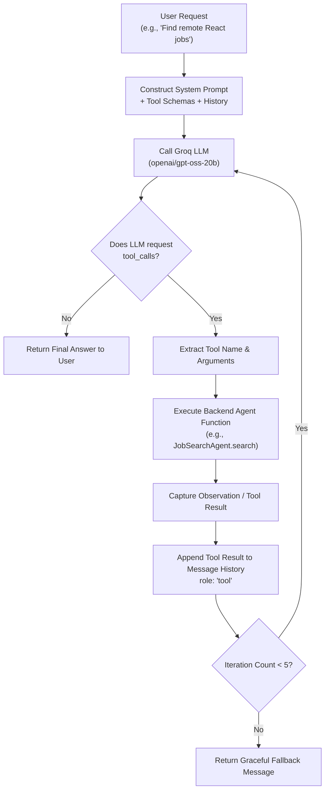

# Generative AI & Agent Architecture: The Engineering Behind AI Job Assistant

This document provides a comprehensive technical breakdown of the Generative AI concepts, LLM integrations, and Agentic design patterns implemented in the **AI Job Assistant** application. It is structured specifically for technical discussions and software engineering interviews.

---

## 1. Core Generative AI Concepts & Fundamentals

### 1.1 What is a Large Language Model (LLM)?
* An LLM is an autoregressive deep neural network trained on massive corpora of text code to predict the probability distribution of the next token given preceding context:
  $$P(w_t \mid w_1, w_2, \dots, w_{t-1})$$
* Modern LLMs use the **Transformer architecture** (Vaswani et al., 2017) relying on multi-head self-attention mechanisms to capture long-range semantic dependencies without recurrent bottlenecking.

### 1.2 Tokens and Tokenization
* Text is not processed as raw strings or characters; it is segmented into subword units called **tokens** using Byte-Pair Encoding (BPE) or WordPiece algorithms.
* In English, 1 token is approximately 0.75 words or ~4 characters. A 1,000-word resume consumes approximately 1,300–1,400 tokens.
* **Context Window:** The maximum sequence length (input prompt + output completion) the model's attention mechanism can process in a single forward pass.
  - In our application, we enforce text truncation (e.g., resumes capped at 8,000 characters $\approx$ 2,000 tokens) to guarantee that inputs never exceed the context window or exhaust the token budget.

### 1.3 Hyperparameters in the Codebase
* **Temperature ($0.0 - 1.0$):**
  - Controls the randomness of the softmax probability distribution:
    $$P_i = \frac{\exp(z_i / T)}{\sum_j \exp(z_j / T)}$$
  - In `resumeAgent.js` (Information Extraction): $T = 0.1$ (Deterministic, greedy sampling to eliminate hallucinations and extract exact dates and skills).
  - In `applicationAgent.js` (Cover Letter Generation): $T = 0.7$ (Balanced creativity, professional variation, and stylistic fluency).
* **Top-P (Nucleus Sampling):** Set to $1.0$ or $0.9$ to sample from the smallest set of tokens whose cumulative probability exceeds $P$.

---

## 2. Groq LPU & Model Selection

### 2.1 Why Groq LPU?
Traditional LLM inference relies on GPUs (e.g. Nvidia H100/A100), which are optimized for parallel batch processing but suffer memory bandwidth bottlenecks during single-stream token generation.

**Groq Language Processing Unit (LPU):**
* **Deterministic Tensor Streaming:** Designed specifically for sequential matrix-vector computations in Transformer inference.
* **SRAM Architecture:** Holds model weights and activations on-chip, delivering extreme memory bandwidth (~80 TB/s).
* **Ultra-Low Latency:** Produces generation speeds of 300 to 500+ tokens per second, reducing user wait time for cover letters from 15 seconds to under 1.5 seconds.

### 2.2 Model Choice: `openai/gpt-oss-20b`
* **Configuration:** Configured as the default model via `process.env.GROQ_MODEL || 'openai/gpt-oss-20b'`.
* **Parameter Efficiency:** At 20 billion parameters, it offers the ideal compromise between reasoning capability, instruction-following fidelity, and inference speed.
* **Structured Tool-Calling Capability:** Trained to reliably emit standard OpenAI-compatible tool call payloads (`tool_calls: [{ function: { name, arguments } }]`), crucial for our ReAct agent loop.

---

## 3. The ReAct Agent Pattern (Reasoning + Acting)

The conversational assistant in `backend/agents/orchestratorAgent.js` is not a simple chat bot; it implements the **ReAct (Reasoning + Acting)** paradigm (Yao et al., 2022).



### 3.1 Tool Schema Registration
The orchestrator registers tools with strict JSON Schema definitions:
```javascript
const availableTools = [
  {
    type: "function",
    function: {
      name: "search_jobs",
      description: "Search for live jobs based on title, skills, and location preferences.",
      parameters: {
        type: "object",
        properties: {
          query: { type: "string", description: "Job title or skill search query" },
          location: { type: "string", description: "Target location or 'Remote'" }
        },
        required: ["query"]
      }
    }
  },
  {
    type: "function",
    function: {
      name: "get_application_status",
      description: "Retrieve current status of tracked job applications.",
      parameters: { type: "object", properties: {} }
    }
  }
  // additional tools: get_matched_jobs, prepare_application, get_resume_summary
];
```

### 3.2 Execution Loop & Termination Conditions
1. Prompt injected with current user context and registered tools.
2. If the LLM generates `tool_calls`, the server resolves the requested function (`search_jobs`, `get_application_status`, etc.).
3. Tool execution output is wrapped in a message with role `"tool"` and sent back to the LLM.
4. **Safety Guard:** Maximum 5 iterations prevents infinite execution loops if the LLM enters repetitive behavior.

---

## 4. Prompt Engineering & Structured Output

### 4.1 Resume Parser System Prompt (`resumeAgent.js`)
To extract structured data from unstructured resumes, we use strict prompt constraints and JSON schema enforcement:

```text
You are an expert resume parsing engine.
Analyze the following resume text and extract candidate information in STRICT JSON format.
Do NOT include markdown formatting, backticks, or preamble. Return ONLY raw JSON matching this schema:
{
  "name": "Full Name",
  "email": "email address",
  "phone": "phone number",
  "location": "City, Country",
  "summary": "Professional summary",
  "skills": ["Skill1", "Skill2"],
  "experienceYears": number,
  "experience": [{ "title": "", "company": "", "duration": "", "highlights": [] }],
  "education": [{ "degree": "", "institution": "", "year": "" }]
}
```

* **Mitigation of JSON Parsing Errors:**
  We implement a sanitizer that strips accidental markdown fences (````json ... ````) before executing `JSON.parse()`. If parsing fails, a fallback regex extraction pattern is invoked.

### 4.2 Application Tailoring Prompt (`applicationAgent.js`)
* Combines candidate resume data + target job specification.
* Injects instructions to avoid generic clichés ("I am writing to express my enthusiasm...").
* Requires the LLM to quantify achievements using metrics present in the resume.

---

## 5. Tavily Search Integration & Web Grounding

### 5.1 Why Tavily instead of Standard Web Scraping / Google Custom Search?
1. **Designed for LLM Context Windows:** Traditional search engines return HTML pages loaded with cookie banners, navigation menus, ads, and CSS scripts. Tavily returns clean, pre-cleaned markdown text and direct URLs.
2. **Real-Time Data Grounding:** Eliminates LLM training cutoff limitations by fetching live, current job postings published within the last 7–30 days.
3. **Domain Filtering:** Supports targeting high-signal hiring domains (e.g., `boards.greenhouse.io`, `jobs.lever.co`, `ashbyhq.com`).

### 5.2 Query Construction Strategy
To ensure freshers do not receive senior roles, `jobSearchAgent.js` constructs targeted multi-operator queries:
```javascript
const query = `"${role}" ("fresher" OR "entry level" OR "junior" OR "associate") site:boards.greenhouse.io OR site:jobs.lever.co`;
```

---

## 6. Hallucination Mitigation & Grounding

Hallucination occurs when an LLM generates syntactically convincing but factually incorrect or ungrounded data.

In this codebase, hallucination is mitigated through four engineering layers:

| Layer | Technique | How It Works in Our App |
| :--- | :--- | :--- |
| **1. Grounding** | Source Retrieval Grounding | LLM is provided actual candidate resume data and Tavily search snippets. It is explicitly prohibited from inventing skills or past jobs. |
| **2. Temperature** | Greedy / Low Temperature Sampling | $T = 0.1$ for extraction prevents the model from embellishing candidate titles or experience years. |
| **3. Deterministic Verification** | Programmatic URL Verification | We never trust LLM-generated URLs. All job links originate directly from verified Tavily API results and pass parallel HTTP reachability checks (`verifyUrlReachability`). |
| **4. Structured Parsing** | JSON Schema Validation | Model outputs are strictly validated against TypeScript interfaces before updating UI or disk storage. |

---

## 7. Safety & Ethical AI Guardrails

### 7.1 Why `AGENT_ALLOW_AUTOMATION=false` is Enforced
A critical design requirement is that the assistant **does NOT autonomously fill or submit job applications**.

**Engineering & Ethical Justification:**
1. **Legal & Terms of Service Compliance:** Most corporate ATS systems (Workday, Greenhouse, Taleo) explicitly forbid automated bots, headless scrapers, and automated form fillers in their terms of use.
2. **Account Banning Risk:** Automated submissions trigger Cloudflare / Imperva bot-detection, risking blacklisting the candidate's IP and email.
3. **Application Quality & Accuracy:** Hallucinated answers on critical compliance questions (e.g., visa sponsorship, background checks, non-competes) could cause instant disqualification or legal issues for the candidate.
4. **Human-in-the-Loop Paradigm:** The AI acts as a **Copilot**—doing the tedious work of finding jobs, scoring fit, and drafting materials—while giving the candidate full agency to review and click "Submit" on the official employer portal.

---

## 8. Interview Talking Points & Deep Questions

* **Q: Why use Groq instead of standard OpenAI or Anthropic APIs?**
  * *Answer:* Groq's LPU architecture delivers ~400 tokens/sec compared to ~40-60 tokens/sec on GPUs. For interactive user chat and multi-turn ReAct loops, low inference latency is critical to prevent UI freezing and user drop-off.
* **Q: How does the ReAct loop handle tools that fail?**
  * *Answer:* Tool executions are wrapped in `try...catch` blocks. If an external service like Tavily fails, the catch block formats a structured error message (`"Error executing tool: Service unavailable"`), which is fed back into the conversation. The LLM can then inform the user cleanly instead of crashing the server.
* **Q: How do you handle rate limits on free-tier LLM providers?**
  * *Answer:* We implement an in-memory sliding-window rate limiter in Express, cache frequent search results, and prune unnecessary conversation turns to conserve tokens per minute (TPM) and requests per minute (RPM).
