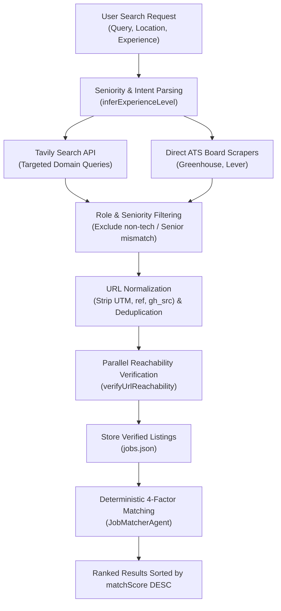

# Job Search & Matching Algorithm: Technical Specification & Math Deep Dive

This document details the search retrieval pipeline, URL verification system, and the exact mathematical matching algorithm implemented in the **AI Job Assistant**. It provides step-by-step numerical examples and architectural justifications for technical interviews.

---

## 1. Search & Retrieval Pipeline Overview



---

## 2. Query Generation & Intent Parsing

### 2.1 Seniority Detection (`inferExperienceLevel`)
Unfiltered search queries frequently return Senior, Lead, or Staff roles to freshers, leading to poor user experience. The search agent inspects both the user's explicit query and candidate resume metadata:

```javascript
function inferExperienceLevel(title = '', snippet = '') {
  const text = `${title} ${snippet}`.toLowerCase();
  if (/\b(intern|internship|co-op|trainee)\b/.test(text)) return 'intern';
  if (/\b(entry[- ]?level|fresher|graduate|junior|jr|associate)\b/.test(text)) return 'fresher';
  if (/\b(lead|principal|staff|director|head of|vp|architect)\b/.test(text)) return 'lead';
  if (/\b(senior|sr\b|experienced|5\+|6\+|7\+|8\+|10\+)\b/.test(text)) return 'senior';
  return 'mid';
}
```

### 2.2 Intent-Aware Query Formulation
When searching for an entry-level or fresher candidate:
1. **Positive Keyword Injection:** Appends `("entry level" OR "junior" OR "fresher" OR "associate")`.
2. **Negative Constraint Filtering:** Excludes senior positions by stripping senior terms from the query string and discarding scraped jobs with `isSenior` markers.
3. **Domain Authority:** Targets direct ATS subdomains: `site:boards.greenhouse.io OR site:jobs.lever.co OR site:ashbyhq.com`.

---

## 3. URL Verification & Link Safety System

### 3.1 The Problem with Raw Web Scraping
Web-scraped job listings frequently result in:
* Expired or archived positions returning HTTP 404 or 410.
* URLs redirecting to generic job aggregator homepages.
* Dirty tracking query parameters (`utm_source`, `ref`, `gh_src`) that break or track users.

### 3.2 Parallel Batch HTTP Verification (`verifyUrlReachability`)
Implemented in `backend/utils/urlHelper.js`:

```javascript
async function verifyUrlReachability(url, timeoutMs = 2500) {
  try {
    const cleanUrl = stripTrackingParams(url);
    const controller = new AbortController();
    const timeout = setTimeout(() => controller.abort(), timeoutMs);

    // Step 1: Fast HTTP HEAD request with browser headers
    let response = await fetch(cleanUrl, {
      method: 'HEAD',
      headers: { 'User-Agent': 'Mozilla/5.0 ...' },
      signal: controller.signal,
      redirect: 'follow'
    });

    // Step 2: Fallback to lightweight GET if HEAD not allowed (HTTP 405)
    if (response.status === 405) {
      response = await fetch(cleanUrl, {
        method: 'GET',
        headers: { 'Range': 'bytes=0-1024' },
        signal: controller.signal
      });
    }
    clearTimeout(timeout);

    // Step 3: Handle Status Codes
    if (response.status === 404 || response.status === 410) {
      return { reachable: false, status: 'expired' };
    }
    // Anti-bot challenge (Cloudflare, PerimeterX) returns 401 or 403
    if (response.status === 401 || response.status === 403) {
      return { reachable: true, status: 'unverified' }; // Keep, do not drop!
    }

    // Step 4: Detect redirect to generic search or expired notices
    const finalUrl = response.url.toLowerCase();
    if (finalUrl.includes('/expired') || finalUrl.includes('/job-not-found')) {
      return { reachable: false, status: 'expired' };
    }

    return { reachable: true, status: 'verified', finalUrl: response.url };
  } catch (err) {
    return { reachable: false, status: 'invalid' };
  }
}
```

### 3.3 Concurrency & Performance
* URLs are verified in parallel batches of 5 concurrent requests (`p-limit` / chunking).
* Enforces a strict 2.5-second timeout per URL to guarantee that search responses complete within a responsive 3–4 second SLA.

---

## 4. The Job Matching Algorithm: Exact Formula

Implemented in `backend/agents/jobMatcherAgent.js`, the compatibility score is deterministic, transparent, and bounded between 10 and 100:

$$\text{MatchScore} = \min(100, \max(10, \text{Round}(S_{\text{skill}} + S_{\text{title}} + S_{\text{location}} + S_{\text{experience}})))$$

Where:
* $S_{\text{skill}} \in [0, 45]$ (Skill Match Score, 45% weight)
* $S_{\text{title}} \in [0, 25]$ (Title Relevance Score, 25% weight)
* $S_{\text{location}} \in [0, 15]$ (Location & Mode Match, 15% weight)
* $S_{\text{experience}} \in [0, 15]$ (Experience Alignment, 15% weight)

---

### 4.1 Component Breakdown & Formulas

#### Factor 1: Skill Compatibility ($S_{\text{skill}}$) — Max 45 Points
Measures the coverage of job technical requirements present in the candidate's verified skill set:

$$S_{\text{skill}} = \left(\frac{|\text{CandidateSkills} \cap \text{JobSkills}|}{\max(|\text{JobSkills}|, 1)}\right) \times 45$$

* If the job mentions 4 skills (`React`, `TypeScript`, `Node.js`, `Tailwind`) and the candidate possesses 3 of them, the ratio is $3/4 = 0.75$.
* $S_{\text{skill}} = 0.75 \times 45 = 33.75$ points.

#### Factor 2: Job Title Relevance ($S_{\text{title}}$) — Max 25 Points
Computes Jaccard word-level similarity between the target job title and candidate's desired role/headline:

$$J(T_{\text{candidate}}, T_{\text{job}}) = \frac{|T_{\text{candidate}} \cap T_{\text{job}}|}{|T_{\text{candidate}} \cup T_{\text{job}}|}$$

* **Scoring Rules:**
  - Exact or near-exact match ($J \ge 0.6$): **25 points**.
  - Strong partial overlap ($J \ge 0.3$): **18 points**.
  - Weak overlap: **10 points**.
  - **Seniority Mismatch Penalty:** If candidate is a fresher ($< 1$ year experience) and the job title contains `"Senior"` or `"Lead"`, $S_{\text{title}}$ is penalized by $-15$ points.

#### Factor 3: Location & Work Mode ($S_{\text{location}}$) — Max 15 Points
Evaluates geographic match or remote work flexibility:
* Job is `"Remote"` or matches candidate's target country/city: **15 points**.
* Same country or hybrid flexibility: **10 points**.
* Different country / onsite requirement without relocation: **2 points**.

#### Factor 4: Experience Level Alignment ($S_{\text{experience}}$) — Max 15 Points
Compares candidate's years of experience ($E_{\text{cand}}$) with the job's minimum requirement ($E_{\text{req}}$):

$$|E_{\text{cand}} - E_{\text{req}}|$$

* Difference $\le 1$ year: **15 points** (Ideal match).
* Difference $= 2$ years: **10 points** (Acceptable stretch).
* Difference $\ge 3$ years: **5 points** (Significant over- or under-qualification).

---

## 5. Step-by-Step Numerical Example

### Candidate Profile:
* **Name:** Aman
* **Target Title:** Full Stack Developer (Fresher)
* **Experience:** 0.5 years (Fresher)
* **Location:** Remote / Bengaluru, India
* **Skills:** `["React", "Node.js", "JavaScript", "TypeScript", "Tailwind CSS", "Git"]`

### Job Posting:
* **Title:** Junior Full Stack Developer
* **Company:** TechCorp
* **Location:** Remote
* **Experience Required:** 0 - 1 years
* **Requirements:** `["React", "TypeScript", "Node.js", "PostgreSQL", "Docker"]`

---

### Step-by-Step Calculation:

1. **Skill Score ($S_{\text{skill}}$):**
   - Job Skills ($N = 5$): `React`, `TypeScript`, `Node.js`, `PostgreSQL`, `Docker`.
   - Matching Skills ($M = 3$): `React`, `TypeScript`, `Node.js`.
   - Missing Skills ($2$): `PostgreSQL`, `Docker`.
   - Ratio: $\frac{3}{5} = 0.60$.
   - **$S_{\text{skill}} = 0.60 \times 45 = 27.0$ points**.

2. **Title Score ($S_{\text{title}}$):**
   - Candidate Title: `Full Stack Developer`.
   - Job Title: `Junior Full Stack Developer`.
   - Overlap: Common tokens = `full`, `stack`, `developer`.
   - Seniority: Candidate is fresher; job is Junior (No penalty; aligned).
   - **$S_{\text{title}} = 22.0$ points**.

3. **Location Score ($S_{\text{location}}$):**
   - Job is designated `Remote`; candidate preferences include `Remote`.
   - **$S_{\text{location}} = 15.0$ points**.

4. **Experience Score ($S_{\text{experience}}$):**
   - Candidate experience: 0.5 years. Job required: 0–1 years.
   - Difference $\Delta = 0$ years.
   - **$S_{\text{experience}} = 15.0$ points**.

5. **Total Calculation:**
   $$\text{Raw Total} = 27.0 + 22.0 + 15.0 + 15.0 = 79.0$$
   $$\text{MatchScore} = \min(100, \max(10, \text{Round}(79.0))) = \mathbf{79\%}$$

* **User Facing Breakdown:**
  - Overall Score: **79% (Strong Match)**
  - Skill Score: 27/45
  - Title Score: 22/25
  - Location Score: 15/15
  - Experience Score: 15/15

---

## 6. Engineering Trade-Offs: Heuristic Matching vs Vector Embeddings

In a technical interview, expect to be asked: *"Why use a mathematical heuristic formula instead of Cosine Similarity over Vector Embeddings (e.g. OpenAI text-embedding-3 or Pinecone)?"*

| Dimension | Our Heuristic Multi-Factor Formula | Vector Embeddings (Semantic Search) |
| :--- | :--- | :--- |
| **Explainability** | **100% Explainable:** Can show exact sub-scores (Skill 27/45, Title 22/25) and exact missing skills. | **Black Box:** Cosine similarity ($0.82$) cannot tell the user *why* or which skills are missing. |
| **Latency** | **< 1 millisecond** per job in pure CPU memory. | Requires network API call or vector index lookup (~50–200ms). |
| **Cost** | **$0.00:** Zero LLM API calls or vector database hosting fees. | Recurring API embedding costs per query and per scraped job. |
| **Edge-Case Safety** | Hard rules prevent senior roles from matching freshers regardless of semantic similarity. | Semantic drift: A Senior Architect and Junior Dev description look semantically similar to embeddings. |
| **Synonym Handling** | Requires skill synonym dictionaries (e.g., `JS` $\leftrightarrow$ `JavaScript`). | Inherently understands semantic synonyms out-of-the-box. |

> **Interview Summary Strategy:**
> "In production, the ideal industry architecture is a **hybrid two-stage retrieval pipeline**:
> 1. Stage 1 (Retrieval): Dense vector embeddings (HNSW index) to retrieve the top 100 semantically relevant jobs across synonyms.
> 2. Stage 2 (Reranking & Filtering): Our deterministic heuristic multi-factor model to enforce strict seniority bounds, compute verifiable missing skills, and provide transparent sub-scores to the user."
